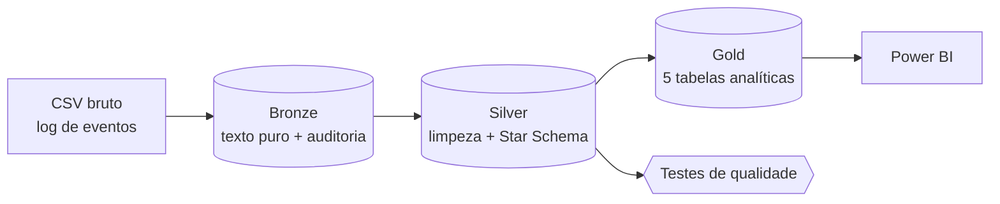
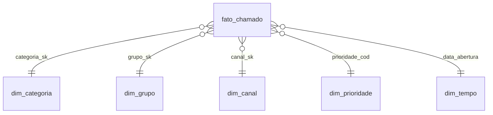

# Service Desk Analytics: pipeline de dados de chamados (Bronze → Silver → Gold)

> MVP de engenharia e análise de dados que transforma o log bruto de chamados de um service desk em indicadores prontos para gestão: SLA, tempo de resolução, retrabalho e picos de demanda.

   

## 1. O problema

Ferramentas de ITSM (como o ServiceNow) gravam um **log de eventos**: cada chamado aparece várias vezes, uma linha por mudança de estado. Na exportação vêm junto nulos como `?`, datas em texto, prioridade como `"3 - Moderate"`, estados com caixa e espaços inconsistentes e linhas duplicadas.

Com isso, montar indicadores vira trabalho manual em planilha, sujeito a erro, e perguntas simples ficam sem resposta confiável:

- Quais categorias mais estouram o SLA?
- Quando a demanda chega (dia e hora)? A escala da equipe acompanha?
- Onde há mais **retrabalho** (reatribuição e reabertura)?
- O que gera muito volume com pouco esforço e poderia virar **autosserviço**?

## 2. A solução

Um pipeline reprodutível em arquitetura **Medallion** (Bronze/Silver/Gold), escrito em Python + SQL sobre **DuckDB**. Roda localmente em cerca de 1 segundo, sem nuvem e sem custo.



| Camada | O que faz | Saída |
|---|---|---|
| **Bronze** | Ingestão fiel do CSV com **todas as colunas como texto**, mais colunas de auditoria (`_ingested_at`, `_source_file`). Nada é corrigido aqui, para preservar a rastreabilidade. | `data/bronze/*.parquet` |
| **Silver** | Remove duplicatas, converte `?` em nulo, faz parse das datas, padroniza estados e canais, extrai o código de prioridade e **reduz o log para 1 linha por chamado**. Modela um **Star Schema**. | `data/silver/*.parquet` |
| **Gold** | Tabelas que respondem às perguntas de negócio, prontas para o dashboard. | `data/gold/*.parquet`, `powerbi/*.csv` |

### Modelo dimensional (Silver)



Detalhes de cada coluna estão em [`docs/dicionario_de_dados.md`](docs/dicionario_de_dados.md).

## 3. Principais achados

> ⚠️ **Os números abaixo vêm de dados sintéticos** (ver seção 5). Eles demonstram o que o pipeline é capaz de revelar; não descrevem nenhuma empresa real.

| | Achado | Ação sugerida |
|---|---|---|
| 🔁 | **Acesso e Senha** responde por **21,7% dos chamados**, mas só **3,5% das horas** de resolução. | Autosserviço de reset de senha e desbloqueio de conta. |
| ⏱️ | **73%** dos chamados P1/P2 de **Software e Instalação** estouram o SLA. | Revisar o fluxo de atendimento em campo e a fila de licenças. |
| 🔀 | **62%** dos chamados de **Rede** passam por 2 ou mais reatribuições. | Melhorar a triagem no N1 com uma árvore de decisão por sintoma. |
| 📈 | Segunda-feira tem **51% mais chamados** que sexta, e **35%** do volume entra entre **8h e 11h**. | Reforçar a escala na segunda pela manhã. |
| 🚨 | Um incidente grave triplicou o volume mensal (1.714 chamados contra cerca de 600). | Ter um plano de comunicação e uma fila de crise. |

<p align="center">
  
  
  
  
</p>

## 4. Qualidade de dados

Toda execução roda `src/quality_checks.py`, que gera [`docs/quality_report.md`](docs/quality_report.md) e falha se algum teste quebrar:

- Chave única (1 linha por chamado) e reconciliação do número de chamados entre Bronze e Silver
- Datas coerentes (resolução nunca antes da abertura)
- Integridade referencial entre a fato e as dimensões
- **SLA recalculado** pelo pipeline concorda com o campo de origem `made_sla` (≥ 95%)
- Taxa de categoria "Não informado" abaixo de 5%

## 5. Fontes de dados

| Fonte | Uso |
|---|---|
| **Dados sintéticos** (`src/generate_synthetic.py`, seed 42) | Padrão do repositório. São 12.000 chamados (~50 mil eventos) entre jan/2025 e jun/2026, gerados com o **mesmo esquema de 36 colunas** e as mesmas "sujeiras" do dataset público abaixo, com padrões embutidos de propósito (pico de segunda, mês de crise, categorias com mais retrabalho). |
| **[Incident management process enriched event log (UCI)](https://archive.ics.uci.edu/dataset/498/incident+management+process+enriched+event+log)**, de Amaral, Fantinato & Peres (2018), DOI [10.24432/C57S4H](https://doi.org/10.24432/C57S4H), licença CC BY 4.0 | Dados **reais e anonimizados** de uma instância ServiceNow: 141.712 eventos e 24.918 incidentes. O pipeline aceita esse CSV diretamente (ver abaixo). |

> Por que sintético por padrão? Para que qualquer pessoa clone o repositório e rode em segundos, e para deixar claro que **nenhum dado de cliente ou empregador foi usado**.

## 6. Como executar

```bash
git clone https://github.com/Oberon-23/service-desk-analytics-mvp.git
cd service-desk-analytics-mvp
python -m venv .venv && source .venv/bin/activate   # Windows: .venv\Scripts\activate
pip install -r requirements.txt

python src/generate_synthetic.py   # 1. gera data/raw/incident_event_log.csv
python src/pipeline.py             # 2. Bronze -> Silver -> Gold
python src/quality_checks.py       # 3. testes de qualidade
python src/charts.py               # 4. gráficos em docs/img
```

**Com os dados reais do UCI:** baixe `incident_event_log.csv` no link da seção 5 e rode
`python src/pipeline.py --input caminho/para/incident_event_log.csv`.

> No dataset real, as datas e os rótulos de categoria têm outro formato (por exemplo `Category 55`). As categorias aparecem codificadas, e talvez seja preciso ajustar o `strptime` em `sql/silver.sql`.

**Power BI:** veja [`docs/guia_power_bi.md`](docs/guia_power_bi.md).

## 7. Estrutura do repositório

```
service-desk-analytics-mvp/
├── src/
│   ├── generate_synthetic.py   # gerador de dados (reprodutível)
│   ├── pipeline.py             # orquestra Bronze -> Silver -> Gold
│   ├── quality_checks.py       # testes de qualidade de dados
│   └── charts.py               # gráficos para README/LinkedIn
├── sql/
│   ├── silver.sql              # limpeza + Star Schema
│   └── gold.sql                # tabelas analíticas
├── data/{raw,bronze,silver,gold}/
├── powerbi/                    # CSVs (separador ;) prontos para importar
└── docs/                       # dicionário, qualidade, guia Power BI, imagens
```

## 8. Limitações e próximos passos

- O SLA é calculado em **horas corridas**. O próximo passo é considerar horário comercial e feriados.
- O sentimento do texto livre (descrição do chamado) não está no escopo; poderia vir com NLP.
- Previsão de volume semanal para dimensionar a equipe (série temporal).
- Orquestração agendada (GitHub Actions) e migração para Databricks/Delta Lake.

## Autor

**Breno Silva**
[LinkedIn](https://www.linkedin.com/in/brenosilvarangel) · [GitHub](https://github.com/Oberon-23) · [Kaggle](https://www.kaggle.com/brenosilvabarros)
