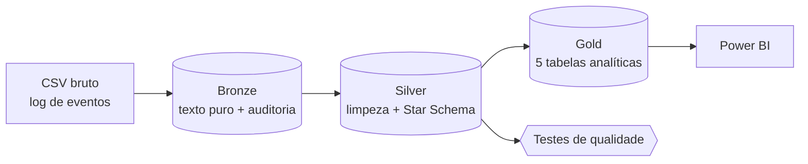
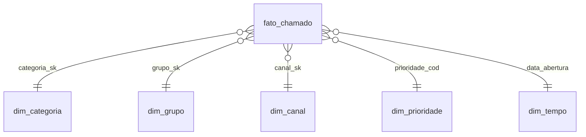
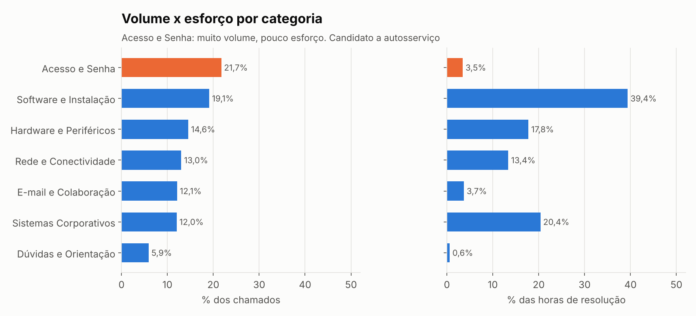
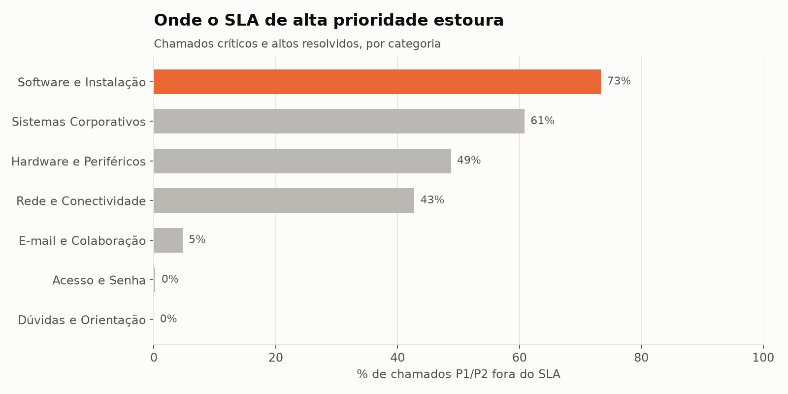
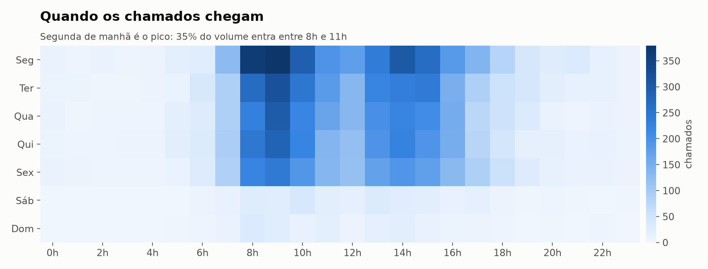
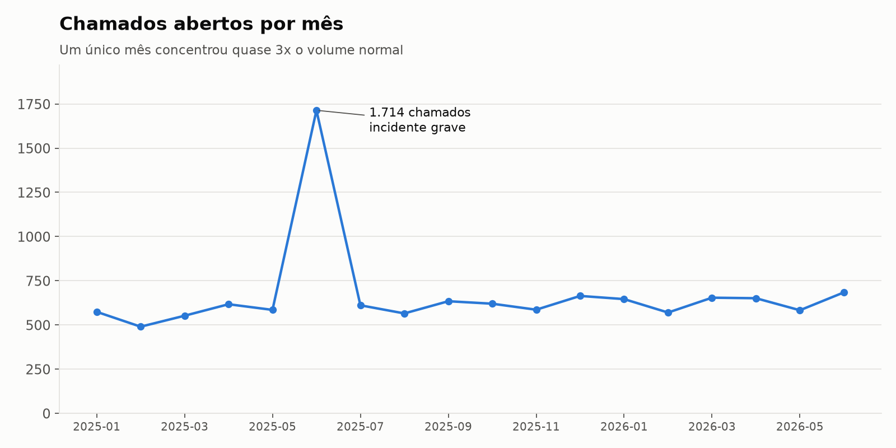
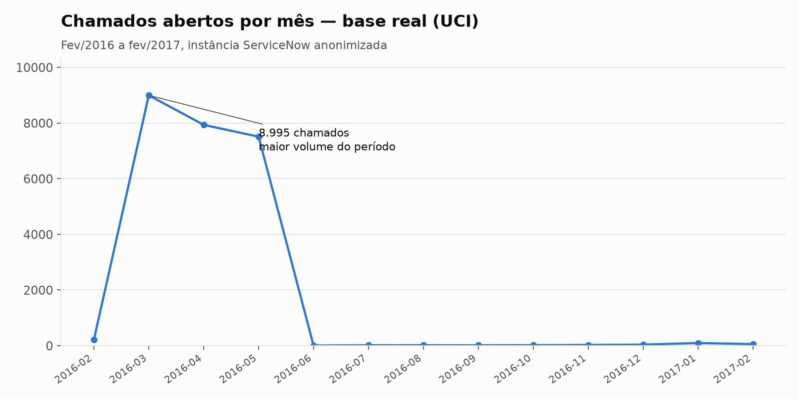
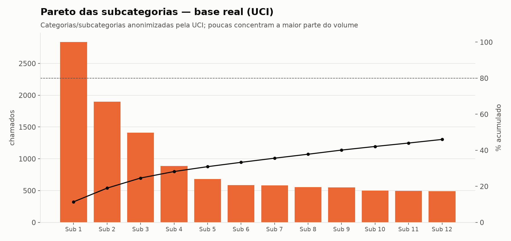
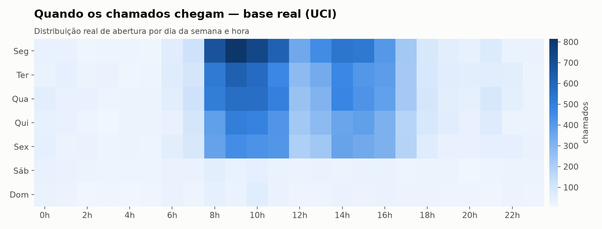
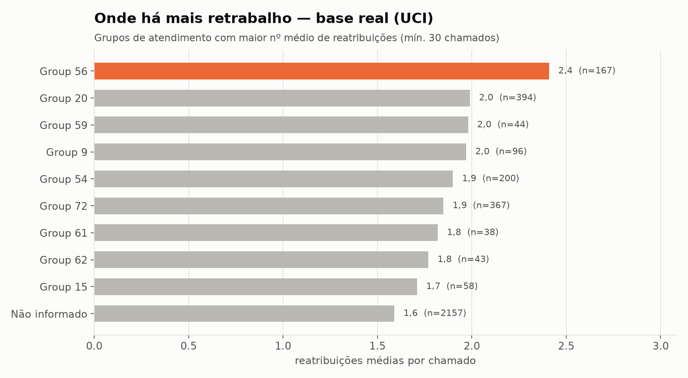

# Service Desk Analytics: pipeline de dados de chamados (Bronze → Silver → Gold)

> MVP de engenharia e análise de dados que transforma o log bruto de chamados de um service desk em indicadores prontos para gestão: SLA, tempo de resolução, retrabalho e picos de demanda.

   

> 📓 Prefere uma versão exploratória (pandas + gráficos, no estilo Kaggle) em vez do pipeline de engenharia? Veja [`notebooks/analise_eda_kaggle.ipynb`](notebooks/analise_eda_kaggle.ipynb) ou a versão publicada no [Kaggle](https://www.kaggle.com/code/brenosilvabarros/an-lise-de-chamados-de-service-desk-itsm-real).

## 1. O problema

Ferramentas de ITSM (como o ServiceNow) gravam um **log de eventos**: cada chamado aparece várias vezes, uma linha por mudança de estado. Na exportação vêm junto nulos como `?`, datas em texto, prioridade como `"3 - Moderate"`, estados com caixa e espaços inconsistentes e linhas duplicadas.

Com isso, montar indicadores vira trabalho manual em planilha, sujeito a erro, e perguntas simples ficam sem resposta confiável:

- Quais categorias mais estouram o SLA?
- Quando a demanda chega (dia e hora)? A escala da equipe acompanha?
- Onde há mais **retrabalho** (reatribuição e reabertura)?
- O que gera muito volume com pouco esforço e poderia virar **autosserviço**?

## 2. A solução

Um pipeline reprodutível em arquitetura **Medallion** (Bronze/Silver/Gold), escrito em Python + SQL sobre **DuckDB**. Roda localmente em cerca de 1 segundo, sem nuvem e sem custo.



| Camada | O que faz | Saída |
|---|---|---|
| **Bronze** | Ingestão fiel do CSV com **todas as colunas como texto**, mais colunas de auditoria (`_ingested_at`, `_source_file`). Nada é corrigido aqui, para preservar a rastreabilidade. | `data/bronze/*.parquet` |
| **Silver** | Remove duplicatas, converte `?` em nulo, faz parse das datas, padroniza estados e canais, extrai o código de prioridade e **reduz o log para 1 linha por chamado**. Modela um **Star Schema**. | `data/silver/*.parquet` |
| **Gold** | Tabelas que respondem às perguntas de negócio, prontas para o dashboard. | `data/gold/*.parquet`, `powerbi/*.csv` |

### Modelo dimensional (Silver)



Detalhes de cada coluna estão em [`docs/dicionario_de_dados.md`](docs/dicionario_de_dados.md).

## 3. Principais achados

> ⚠️ **Os números abaixo vêm de dados sintéticos** (ver seção 5). Eles demonstram o que o pipeline é capaz de revelar; não descrevem nenhuma empresa real.

| | Achado | Ação sugerida |
|---|---|---|
| 🔁 | **Acesso e Senha** responde por **21,7% dos chamados**, mas só **3,5% das horas** de resolução. | Autosserviço de reset de senha e desbloqueio de conta. |
| ⏱️ | **73%** dos chamados P1/P2 de **Software e Instalação** estouram o SLA. | Revisar o fluxo de atendimento em campo e a fila de licenças. |
| 🔀 | **62%** dos chamados de **Rede** passam por 2 ou mais reatribuições. | Melhorar a triagem no N1 com uma árvore de decisão por sintoma. |
| 📈 | Segunda-feira tem **51% mais chamados** que sexta, e **35%** do volume entra entre **8h e 11h**. | Reforçar a escala na segunda pela manhã. |
| 🚨 | Um incidente grave triplicou o volume mensal (1.714 chamados contra cerca de 600). | Ter um plano de comunicação e uma fila de crise. |

<p align="center">
  
  
  
  
</p>

## 4. Qualidade de dados

Toda execução roda `src/quality_checks.py`, que gera [`docs/quality_report.md`](docs/quality_report.md) e falha se algum teste quebrar:

- Chave única (1 linha por chamado) e reconciliação do número de chamados entre Bronze e Silver
- Datas coerentes (resolução nunca antes da abertura)
- Integridade referencial entre a fato e as dimensões
- **SLA recalculado** pelo pipeline concorda com o campo de origem `made_sla` (≥ 95%)
- Taxa de categoria "Não informado" abaixo de 5%

## 5. Fontes de dados

| Fonte | Uso |
|---|---|
| **Dados sintéticos** (`src/generate_synthetic.py`, seed 42) | Padrão do repositório. São 12.000 chamados (~50 mil eventos) entre jan/2025 e jun/2026, gerados com o **mesmo esquema de 36 colunas** e as mesmas "sujeiras" do dataset público abaixo, com padrões embutidos de propósito (pico de segunda, mês de crise, categorias com mais retrabalho). |
| **[Incident management process enriched event log (UCI)](https://archive.ics.uci.edu/dataset/498/incident+management+process+enriched+event+log)**, de Amaral, Fantinato & Peres (2018), DOI [10.24432/C57S4H](https://doi.org/10.24432/C57S4H), licença CC BY 4.0 | Dados **reais e anonimizados** de uma instância ServiceNow: 141.712 eventos e 24.918 incidentes. O pipeline aceita esse CSV diretamente (ver abaixo). |

> Por que sintético por padrão? Para que qualquer pessoa clone o repositório e rode em segundos, e para deixar claro que **nenhum dado de cliente ou empregador foi usado**.

## 6. Resultado rodando com a base real (UCI)

O mesmo SQL de Silver/Gold (sem nenhuma alteração) foi rodado contra o CSV real de 141.712 eventos. Resultado: **24.918 incidentes**, de fev/2016 a fev/2017, de uma instância ServiceNow anonimizada.

| | Achado | Leitura |
|---|---|---|
| 📊 | Um único mês (mar/2016) concentrou **8.995 chamados** — quase o dobro do mês seguinte e **~150x** a média dos meses finais do período. | O log real tem uma janela de alto volume seguida por uma cauda quase vazia — provavelmente o período em que a instância estava em uso ativo de verdade. |
| 📈 | As **3 subcategorias mais comuns** (de ~190 no total, todas anonimizadas pela UCI) respondem por **24,6%** dos chamados — bem menos concentrado que no cenário sintético. | Demanda real tende a ser mais pulverizada entre categorias do que um cenário didático. |
| 🔀 | O grupo com mais retrabalho reatribui um chamado em média **2,4x** (n=167), e **22%** de todos os chamados resolvidos passam por 2+ reatribuições. | Nível de retrabalho real é material — vale investigar critérios de triagem/roteamento. |
| 🕒 | O pico de abertura é **segunda a quinta, 8h–11h e 13h–16h**; fins de semana praticamente não têm chamados. | Confirma o padrão clássico de suporte corporativo (sem plantão de fim de semana). |
| ⚠️ | O SLA recalculado com os alvos-padrão do pipeline (4h/8h/24h/72h por prioridade) bate com o campo original `made_sla` em apenas **81,4%** dos casos — abaixo do limiar de 95% do teste de qualidade (ver seção 4), que passa com os dados sintéticos. | **Achado honesto, não escondido**: a UCI não documenta a política de SLA real dessa organização. Os alvos usados no pipeline são uma suposição razoável (padrão ITIL), não o SLA oficial dela — por isso o teste foi desenhado para *alertar* essa divergência, em vez de forçar concordância. Em um cenário real, o próximo passo seria validar os alvos de SLA com o time de negócio antes de usar esse indicador para decisão. |

<p align="center">
  
  
  
  
</p>

**Como reproduzir:** baixe `incident_event_log.csv` em [archive.ics.uci.edu/dataset/498](https://archive.ics.uci.edu/dataset/498/incident+management+process+enriched+event+log) (licença CC BY 4.0), salve em `data/real/incident_event_log.csv` e rode:

```bash
python src/run_real_analysis.py          # Bronze -> Silver -> Gold, saída em data/gold_real/ e powerbi_real/
python src/quality_checks.py --real      # testes de qualidade -> docs/quality_report_real.md
python src/charts_real.py                # gráficos em docs/img_real/
```

> O CSV real (~46 MB) não é commitado no repositório — só os resultados agregados (pequenos) ficam versionados em `data/gold_real/` e `powerbi_real/`.

## 7. Como executar

```bash
git clone https://github.com/Oberon-23/service-desk-analytics-mvp.git
cd service-desk-analytics-mvp
python -m venv .venv && source .venv/bin/activate   # Windows: .venv\Scripts\activate
pip install -r requirements.txt

python src/generate_synthetic.py   # 1. gera data/raw/incident_event_log.csv
python src/pipeline.py             # 2. Bronze -> Silver -> Gold
python src/quality_checks.py       # 3. testes de qualidade
python src/charts.py               # 4. gráficos em docs/img
```

**Com os dados reais do UCI:** o pipeline já roda sem ajuste algum contra o CSV real — o formato de data (`dd/mm/AAAA HH:MM`) e de prioridade (`"3 - Moderate"`) é o mesmo do dataset sintético. Use `python src/pipeline.py --input caminho/para/incident_event_log.csv` para processar no mesmo lugar dos dados sintéticos, ou `python src/run_real_analysis.py` para manter os dois resultados separados (ver seção 6).

**Power BI:** veja [`docs/guia_power_bi.md`](docs/guia_power_bi.md).

## 8. Estrutura do repositório

```
service-desk-analytics-mvp/
├── src/
│   ├── generate_synthetic.py   # gerador de dados (reprodutível)
│   ├── pipeline.py             # orquestra Bronze -> Silver -> Gold (dados sintéticos por padrão)
│   ├── run_real_analysis.py    # mesmo pipeline, saída separada, para a base real da UCI
│   ├── quality_checks.py       # testes de qualidade de dados
│   ├── charts.py                # gráficos (dados sintéticos) para README/LinkedIn
│   └── charts_real.py          # gráficos a partir do resultado com a base real
├── sql/
│   ├── silver.sql              # limpeza + Star Schema (usado nos dois cenários)
│   └── gold.sql                # tabelas analíticas (usado nos dois cenários)
├── data/{raw,bronze,silver,gold}/       # dados sintéticos (o CSV bruto não é commitado)
├── data/{real,gold_real}/               # base real: CSV bruto não commitado; gold_real/ é versionado
├── powerbi/, powerbi_real/              # CSVs (separador ;) prontos para importar
└── docs/                                # dicionário, qualidade, guia Power BI, imagens (img/ sintético, img_real/ real)
```

## 9. Limitações e próximos passos

- O SLA é calculado em **horas corridas**. O próximo passo é considerar horário comercial e feriados.
- Os alvos de SLA por prioridade (4h/8h/24h/72h) são uma suposição razoável, não a política oficial da organização por trás da base real — ver o achado da seção 6.
- O sentimento do texto livre (descrição do chamado) não está no escopo; poderia vir com NLP.
- Previsão de volume semanal para dimensionar a equipe (série temporal).
- Orquestração agendada (GitHub Actions) e migração para Databricks/Delta Lake.

## Autor

**Breno Silva**
[LinkedIn](https://www.linkedin.com/in/brenosilvarangel) · [GitHub](https://github.com/Oberon-23) · [Kaggle](https://www.kaggle.com/brenosilvabarros)
